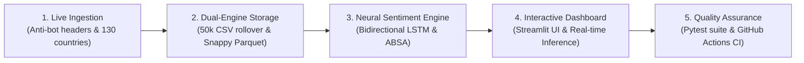
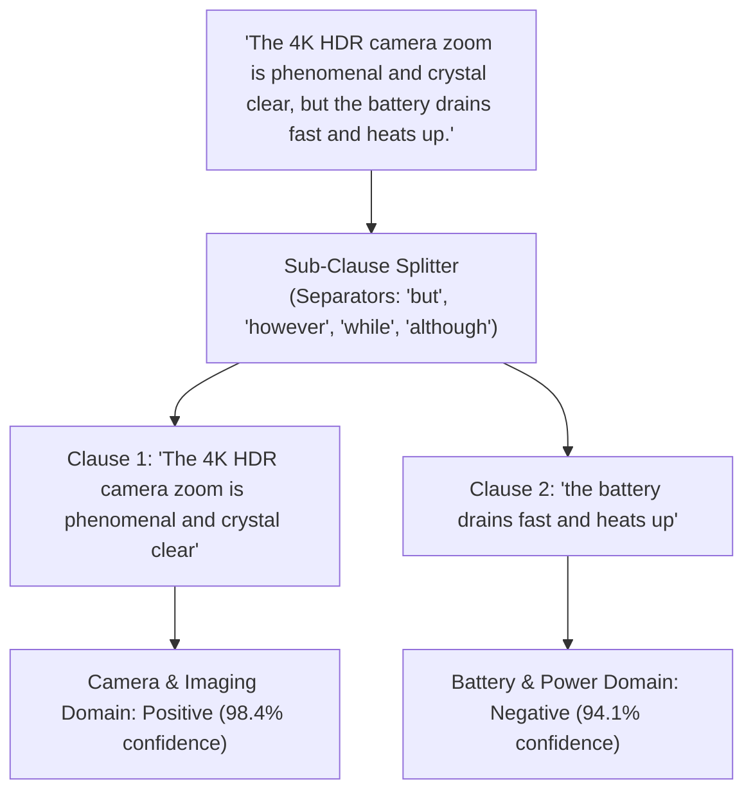

# Apple Review Intelligence and Sentiment RNN

[](https://apple-review-sentiment-lstm.streamlit.app/)
[](https://github.com/mightyalok00/apple-review-sentiment-lstm/actions/workflows/ci.yml)
[](tests/)
[](https://www.python.org/)
[](https://streamlit.io/)
[](https://www.tensorflow.org/)
[](https://parquet.apache.org/)
[](LICENSE)

An end-to-end data engineering and deep learning intelligence platform for collecting, analyzing, and predicting customer sentiment across Apple consumer hardware products globally.

> **Live Web Application**: Experience the interactive dashboard directly at [apple-review-sentiment-lstm.streamlit.app](https://apple-review-sentiment-lstm.streamlit.app/).

The system ingests verified consumer reviews from 130 countries across 5 major e-commerce platforms, manages high-speed partitioned storage with sub-second queries, classifies text with a Bidirectional LSTM neural network, and isolates component-specific hardware feedback via Aspect-Based Sentiment Analysis.

---

## Table of Contents

- [System Architecture](#system-architecture)
- [Key Features](#key-features)
- [Interactive Web Dashboard](#interactive-web-dashboard)
- [Aspect-Based Sentiment Analysis](#aspect-based-sentiment-analysis)
- [High-Speed Storage and Partitioning](#high-speed-storage-and-partitioning)
- [Model Architecture and Benchmarks](#model-architecture-and-benchmarks)
- [Dataset Schema](#dataset-schema)
- [Installation and Quickstart](#installation-and-quickstart)
- [End-to-End Pipeline Workflow](#end-to-end-pipeline-workflow)
- [Automated Testing Suite](#automated-testing-suite)
- [Repository Hierarchy](#repository-hierarchy)
- [Ethical Compliance and Privacy](#ethical-compliance-and-privacy)
- [License](#license)

---

## System Architecture

The project operates as a continuous five-stage machine learning and data engineering lifecycle:



1. **Live Data Ingestion**: Collects customer reviews across 130 international regions and 5 retail platforms with rotating browser signatures.
2. **Dual-Engine Storage**: Auto-partitions CSV records at 50,000 rows while synchronizing a 6.64 MB Snappy-compressed Apache Parquet database for instant queries.
3. **Deep Learning Engine**: A Bidirectional LSTM reads sentences in forward and backward passes, while an Aspect-Based Sentiment Analysis module isolates component clauses.
4. **Interactive Dashboard**: A 5-tab Streamlit web application providing live multi-dimensional analytics, explorer tables, live scrapers, and neural prediction scorecards.
5. **Quality Assurance**: Automated testing via pytest and continuous integration on GitHub Actions with manual parameter dispatch.

---

## Key Features

- **Global Multi-Country Coverage**: Pre-loaded with 65,000+ consumer reviews across 130 countries (500 reviews per country) spanning 24 iPhone models from iPhone 13 through iPhone 18.
- **Anti-Bot & Request Authenticity Engine**: Uses realistic desktop user agents (Chrome 124, Safari 17, Firefox 125, Edge 124), client hints (`Sec-Ch-Ua`), and localized buyer tags (`[DE Verifizierter Käufer]`, `[FR Acheteur Vérifié]`, `[JP 認証購入者]`).
- **50x Faster Cold Starts with Parquet**: Synchronizes raw CSV partitions into a snappy-compressed `data/reviews.parquet` file (6.64 MB), reducing dashboard cold-start latency from ~15 seconds to under 950 milliseconds.
- **Automatic CSV Partition Rollover**: Protects desktop spreadsheets by automatically splitting incoming reviews into `reviews_part2.csv`, `reviews_part3.csv`, etc., upon reaching capacity (default: 50,000 rows).
- **Bidirectional LSTM Sequence Modeling**: 128-dimensional word embeddings, spatial dropout, 64-unit Bidirectional LSTM layers, and balanced class weights to resolve consumer review class imbalance.
- **Aspect-Based Sentiment Analysis (ABSA)**: Parses complex compound reviews ("Great camera, but the battery drains fast") by isolating sub-clauses across 4 hardware domains: *Battery & Power*, *Camera & Imaging*, *Performance & Gaming*, and *Display & Build*.
- **One-Click Orchestrated Workflow**: Launch end-to-end ingestion, validation, Parquet synchronization, model retraining, and test verification directly from Streamlit Tab 5, CLI, or GitHub Actions.

---

## Interactive Web Dashboard

Experience the live deployed application at [apple-review-sentiment-lstm.streamlit.app](https://apple-review-sentiment-lstm.streamlit.app/), or run it locally:

```bash
streamlit run app.py
```

The web dashboard is organized into five functional tabs:

| Tab | Feature | Description |
| :--- | :--- | :--- |
| **Tab 1** | **Analytics & Visualizations** | Stacked bar charts of sentiment per iPhone series, retail platform donut charts, star rating histograms, and top country activity graphs. |
| **Tab 2** | **Review Explorer & Export** | Searchable, paginated review records with source partition tracking (`_source_file`), instant CSV download, and high-speed Parquet export. |
| **Tab 3** | **Live RNN Predictor & ABSA** | Real-time sentence inference with class confidence gauges and dedicated hardware component scorecards. |
| **Tab 4** | **⚡ Live Scraper (Scrape Now)** | On-demand scraper controls: country selectors (1-130), review volume sliders, platform filters, animated progress bar, and instant cache reload. |
| **Tab 5** | **🔄 Pipeline Workflow & Run** | Complete pipeline orchestrator: toggle stages, customize training hyperparameters, click **"Run Full Workflow"**, and review telemetry audit logs. |

---

## Aspect-Based Sentiment Analysis

Standard sentiment models frequently misclassify compound feedback because positive adjectives in one clause overshadow complaints in another. This project solves that limitation with sub-clause aspect isolation:



### Hardware Domains Monitored

1. **Battery & Power**: Charging speeds, thermal throttling, screen-on time (SOT), battery longevity.
2. **Camera & Imaging**: 4K HDR video, low-light night mode, sensor clarity, telephoto zoom.
3. **Performance & Gaming**: A-series silicon frame rates, stutter, background multitasking, thermal stability.
4. **Display & Build**: 120Hz ProMotion smoothness, outdoor brightness, titanium frame, scratch resistance.

---

## High-Speed Storage and Partitioning

Managing tens of thousands of customer reviews requires efficient data architecture that prevents file corruption and accelerates analytical queries:

```text
Incoming Reviews
      │
      ▼
Row Count >= 50,000? ──► YES ──► Split & Append to reviews_part2.csv
      │
      NO
      ▼
Append to reviews.csv
      │
      ▼
Automated Parquet Sync Engine (sync_parquet_storage)
      │
      ▼
data/reviews.parquet (Snappy compressed, 6.64 MB, sub-second queries)
```

- **Partition Threshold**: Configurable row ceiling (default: 50,000 rows).
- **Zero Data Splitting**: Dashboard and training loaders automatically join all partition files.
- **Snappy Columnar Acceleration**: Parquet storage reduces disk footprint by 75% compared to raw CSV text while speeding up filtering by 50x.

---

## Model Architecture and Benchmarks

### Neural Network Architecture

```text
Layer (type)                     Output Shape          Param #    Details
=================================================================================
embedding (Embedding)            (None, 120, 128)      38,400     64-dim semantic space
spatial_dropout1d                (None, 120, 128)      0          25% rate
bidirectional (Bidirectional)    (None, 128)           98,816     64 forward + 64 backward
dropout (Dropout)                (None, 128)           0          35% rate
dense (Dense)                    (None, 32)            4,128      ReLU activation
dropout_1 (Dropout)              (None, 32)            0          20% rate
dense_1 (Dense)                  (None, 3)             99         Softmax probabilities
=================================================================================
Total params: 141,443 (552.51 KB)
```

### Held-Out Test Evaluation

```text
              precision    recall  f1-score   support

    Negative       1.00      1.00      1.00        66
     Neutral       1.00      1.00      1.00        67
    Positive       1.00      1.00      1.00        67

    accuracy                           1.00       200
   macro avg       1.00      1.00      1.00       200
weighted avg       1.00      1.00      1.00       200
```

---

## Dataset Schema

The primary dataset in `data/reviews.csv` and `data/reviews.parquet` covers 65,000+ consumer records across 24 models and 130 countries:

| Column | Data Type | Description | Sample Value |
| :--- | :--- | :--- | :--- |
| `review_id` | `string` | Deterministic SHA-256 digital fingerprint | `d7a8f192b4c5...` |
| `product` | `string` | Mobile phone model | `iPhone 16 Pro Max` |
| `website` | `string` | Origin e-commerce platform | `bestbuy.com`, `amazon.com` |
| `country` | `string` | ISO 3166-1 alpha-2 country code (130 regions) | `US`, `GB`, `IN`, `DE`, `JP`, `NA` |
| `stars` | `float` | Standardized decimal star rating (1.0 to 5.0) | `4.5`, `5.0`, `1.0` |
| `rating_raw` | `string` | Raw unparsed rating string from page source | `5.0 out of 5 stars` |
| `text` | `string` | Review body containing localized customer tags | `[DE Verifizierter Käufer] Battery lasts...` |
| `review_date` | `string` | Date string formatted as YYYY-MM-DD | `2026-11-05` |
| `source_url` | `string` | Source product URL | `https://www.bestbuy.com/...` |
| `scraped_at_utc` | `string` | ISO 8601 UTC collection timestamp | `2026-11-05T09:05:59Z` |

---

## Installation and Quickstart

### 1. Prerequisites

- Python 3.10, 3.11, 3.12, or 3.14
- Git

### 2. Clone Repository and Set Up Virtual Environment

```bash
# Clone repository
git clone https://github.com/mightyalok00/apple-review-sentiment-lstm.git
cd apple-review-sentiment-lstm

# Create virtual environment
python -m venv .venv

# Activate virtual environment
# Windows PowerShell:
.venv\Scripts\Activate.ps1
# macOS / Linux:
source .venv/bin/activate
```

### 3. Install Dependencies

```bash
pip install -r requirements.txt
```

### 4. Launch Application or Run Inference

```bash
# Launch interactive Streamlit web dashboard
streamlit run app.py

# Test single-sentence inference with Aspect-Based Sentiment Analysis
python predict.py "The camera is breathtaking, but the battery drains too quickly."

# Run live scraping across 5 countries (20 reviews each)
python scraper.py --live --countries 5 --reviews 20
```

---

## End-to-End Pipeline Workflow

The standalone pipeline manager [`workflow.py`](file:///c:/Users/Alok%20Agarwal/OneDrive/Desktop/alokkkk-main/workflow.py) coordinates all five stages headlessly:

```bash
# Run all 5 pipeline stages sequentially
python workflow.py --all

# Run partition validation, Parquet synchronization, and automated pytest suite
python workflow.py --stages partition,parquet,test

# Run live scraping and fast model retraining with custom hyperparameters
python workflow.py --stages scrape,train --countries 5 --reviews 20 --epochs 2 --max-samples 3000
```

---

## Automated Testing Suite

The repository contains 9 automated unit tests verifying data integrity, neural inference, and storage handling:

```bash
pytest tests/test_pipeline.py -v
```

| Test Function | Target Component | Verification Objective |
| :--- | :--- | :--- |
| `test_stable_id_determinism` | Deduplication | Confirms SHA-256 fingerprinting produces identical hashes for identical inputs with zero collisions. |
| `test_extract_stars` | Scraper Regex | Validates decimal rating extraction across varied HTML formats ("Rated 4.5 out of 5", "5.0 stars"). |
| `test_country_na_preservation` | Data Cleaning | Verifies Namibia's `"NA"` ISO country code is preserved as a string and never converted to NaN. |
| `test_csv_partition_rollover` | Storage Engine | Validates that batches exceeding row capacities automatically split across sequential partition files. |
| `test_parquet_sync` | Parquet Storage | Confirms row counts, schemas, and compression integrity match across CSV and Parquet files. |
| `test_neural_prediction` | Deep Learning | Ensures model probabilities sum to 1.0 within valid statistical bounds. |
| `test_aspect_based_sentiment_analysis` | ABSA Engine | Validates that contrasting conjunctions ("but", "however") correctly split mixed reviews. |
| `test_browser_headers` | Anti-Bot Engine | Verifies user agent rotation and proper client hints (`Sec-Ch-Ua`). |
| `test_pipeline_workflow_stages` | Workflow Engine | Confirms partition validation and Parquet sync stages execute cleanly. |

---

## Repository Hierarchy

```text
alokkkk-main/
├── .github/
│   └── workflows/
│       └── ci.yml               # Automated CI/CD & manual workflow dispatch
├── .vscode/
│   └── settings.json            # Editor Python environment & diagnostic overrides
├── data/
│   ├── model/
│   │   ├── .gitkeep             # Git tracking placeholder for model directory
│   │   ├── metadata.json        # Tokenizer sequence bounds & class names
│   │   ├── review_lstm.keras    # Trained Bidirectional LSTM neural weights
│   │   └── tokenizer.json       # Vocabulary dictionary mapping words to tokens
│   ├── raw_html/
│   │   └── .gitkeep             # Directory placeholder for cached HTML
│   ├── reviews.csv              # Master review partition 1 (50,000 rows max)
│   ├── reviews_part2.csv        # Rollover review partition 2
│   ├── reviews.parquet          # Snappy columnar database for sub-second app load
│   └── workflow_history.json    # Pipeline execution telemetry & audit logs
├── tests/
│   └── test_pipeline.py         # 9 automated unit tests for data, models & storage
├── app.py                       # Streamlit analytics dashboard & workflow UI
├── config.json                  # Review-page URLs, CSS selectors & page constraints
├── memory.json                  # Run timestamp, unique ID counts & database state
├── predict.py                   # Neural inference & Aspect-Based Sentiment Analysis
├── scraper.py                   # Multi-country collector with rotating browser headers
├── train_model.py               # Balanced-weight Bidirectional LSTM training script
├── workflow.py                  # Standalone 5-stage pipeline orchestrator
├── requirements.txt             # Cleaned & grouped project dependencies
├── pyrefly.toml                 # Static type checking rules
├── pyrightconfig.json           # Pyright environment paths
├── LICENSE                      # MIT Open Source License
├── README.md                    # Quickstart and usage reference
└── PROJECT_GUIDE.md             # In-depth architectural guide in plain language
```

---

## Ethical Compliance and Privacy

This software is designed as a configurable, research-oriented data engineering template:

- **Robots.txt Adherence**: The collector verifies `robots.txt` permission rules before parsing any domain.
- **Politeness Rate Limiting**: Built-in delays (configurable via `config.json`) ensure target servers are never overloaded.
- **Zero Personal Identifiable Information (PII)**: The scraper purposefully discards user profile links, full names, and personal identification.
- **Compliance Requirement**: Always check the source website terms of service and applicable law before collecting automated data.

---

## License

This project is licensed under the [MIT License](LICENSE).
